# ERD Proposal

> Historical target model, not a literal inventory of the current database. For baseline and impact-mapping evidence, the ordered files in `backend/migrations` are authoritative. Names and entities shown only here—such as capability tables, split movement headers/lines, `audit_logs`, or per-document sequence tables—must not be treated as implemented.

## Modeling principles

- PostgreSQL UUID primary keys; separate human-readable document numbers.
- Transaction lines preserve commercial snapshots (`product_sku`, `product_name`, `unit_price`) so history does not change when master data changes.
- Quantity and money use fixed precision, never float.
- Transaction documents are not hard deleted.
- Ledger and audit tables are append-only.
- Foreign keys protect identity; domain rules protect legal state transitions.

## Logical ERD

```mermaid
erDiagram
    USERS ||--o{ USER_ROLES : has
    USERS ||--o{ USER_ACTION_TOKENS : receives
    USERS ||--o{ AUTH_SESSIONS : authenticates
    AUTH_SESSIONS ||--o{ REFRESH_TOKENS : rotates
    ROLES ||--o{ USER_ROLES : grants
    ROLES ||--o{ ROLE_PERMISSIONS : has
    PERMISSIONS ||--o{ ROLE_PERMISSIONS : includes

    SUPPLIERS ||--o{ PURCHASE_ORDERS : receives
    CUSTOMERS ||--o{ SALES_ORDERS : places
    PRODUCTS ||--o{ PURCHASE_REQUEST_LINES : requested
    PRODUCTS ||--o{ PURCHASE_ORDER_LINES : ordered
    PRODUCTS ||--o{ SALES_ORDER_LINES : sold
    WAREHOUSES ||--o{ STOCK_MOVEMENTS : contains
    WAREHOUSES ||--o| ORGANIZATION_SETTINGS : defaults

    PURCHASE_REQUESTS ||--|{ PURCHASE_REQUEST_LINES : contains
    PURCHASE_REQUESTS ||--o| PURCHASE_ORDERS : converted_to
    PURCHASE_ORDERS ||--|{ PURCHASE_ORDER_LINES : contains
    PURCHASE_ORDERS ||--o{ GOODS_RECEIPTS : fulfilled_by
    GOODS_RECEIPTS ||--|{ GOODS_RECEIPT_LINES : contains
    PURCHASE_ORDER_LINES ||--o{ GOODS_RECEIPT_LINES : received_against

    SALES_ORDERS ||--|{ SALES_ORDER_LINES : contains
    SALES_ORDERS ||--o{ DELIVERIES : fulfilled_by
    DELIVERIES ||--|{ DELIVERY_LINES : contains
    SALES_ORDER_LINES ||--o{ DELIVERY_LINES : delivered_against

    STOCK_MOVEMENTS ||--|{ STOCK_MOVEMENT_LINES : contains
    PRODUCTS ||--o{ STOCK_MOVEMENT_LINES : moves
    PRODUCTS ||--o{ STOCK_BALANCES : projected
    WAREHOUSES ||--o{ STOCK_BALANCES : projected
    INVENTORY_ADJUSTMENTS ||--|{ INVENTORY_ADJUSTMENT_LINES : contains
    INVENTORY_ADJUSTMENTS ||--o| STOCK_MOVEMENTS : posts

    PURCHASE_ORDERS ||--o{ SUPPLIER_INVOICES : billed_by
    SUPPLIER_INVOICES ||--|{ SUPPLIER_INVOICE_LINES : contains
    SUPPLIER_PAYMENTS ||--|{ SUPPLIER_PAYMENT_ALLOCATIONS : allocates
    SUPPLIER_INVOICES ||--o{ SUPPLIER_PAYMENT_ALLOCATIONS : paid_by

    SALES_ORDERS ||--o| SALES_INVOICES : billed_by
    SALES_INVOICES ||--|{ SALES_INVOICE_LINES : contains
    CUSTOMER_PAYMENTS ||--|{ CUSTOMER_PAYMENT_ALLOCATIONS : allocates
    SALES_INVOICES ||--o{ CUSTOMER_PAYMENT_ALLOCATIONS : paid_by

    USERS ||--o{ AUDIT_LOGS : acts
```

## Core tables

### Identity and authorization

| Table | Key columns | Constraints / notes |
|---|---|---|
| `users` | `id`, `email`, `password_hash`, `name`, `status`, `version` | unique normalized email; no plaintext credentials |
| `roles` | `id`, `code`, `name` | seeded `ADMIN`, `OPERATOR`; role bundles remain configurable |
| `permissions` | `id`, `code` | capability names such as `purchase.approve` |
| `user_roles` | `user_id`, `role_id` | composite PK |
| `role_permissions` | `role_id`, `permission_id` | composite PK |
| `auth_sessions` | `id`, `user_id`, `access_token_hash`, `access_expires_at`, `csrf_token_hash`, `idle_expires_at`, `absolute_expires_at`, `token_family_id`, `revoked_at`, `revocation_reason`, `last_seen_at` | opaque access token and CSRF token stored only as hashes; immediate revocation lookup |
| `refresh_tokens` | `id`, `session_id`, `token_hash`, `expires_at`, `used_at`, `replaced_by_id`, `revoked_at` | append-only rotation history permits reuse detection; raw token never stored |
| `user_action_tokens` | `id`, `user_id`, `type`, `token_hash`, `status`, `expires_at`, `shared_at`, `used_at`, `revoked_at`, `created_by` | type `INVITATION|PASSWORD_RESET`; unique token hash; raw token never stored |

### Master data

| Table | Key columns | Constraints / notes |
|---|---|---|
| `products` | `id`, `sku`, `name`, `unit_id`, `default_purchase_price`, `default_sale_price`, `status`, `version` | unique SKU; prices non-negative |
| `units` | `id`, `code`, `name`, `precision` | unique code |
| `suppliers` | `id`, `code`, `name`, contact/address fields, `status`, `version` | unique code |
| `customers` | `id`, `code`, `name`, contact/address fields, `status`, `version` | unique code |
| `warehouses` | `id`, `code`, `name`, `status`, `version` | at least one active warehouse |
| `organization_settings` | singleton `id`, `default_currency`, `timezone`, `default_warehouse_id` | created only after `warehouses`; defaults: `IDR`, `Asia/Jakarta`, and an active warehouse; maker-checker is not configurable |

### Purchasing

| Table | Key columns | Constraints / notes |
|---|---|---|
| `purchase_requests` | `id`, `number`, `status`, `purpose`, `requested_by`, `reviewed_by`, `rejection_reason`, `copied_from_id`, cancellation fields, `version` | unique number; reviewer differs from creator; rejected is terminal |
| `purchase_request_lines` | `id`, `purchase_request_id`, `product_id`, snapshot fields, `quantity`, `notes` | quantity > 0 |
| `purchase_orders` | `id`, `number`, `purchase_request_id`, `supplier_id`, `warehouse_id`, `status`, dates, totals, cancellation fields, `version` | one PO per PR in MVP |
| `purchase_order_lines` | `id`, `purchase_order_id`, `purchase_request_line_id`, product snapshots, `ordered_qty`, `unit_price`, tax/discount/line total | quantity > 0 |
| `goods_receipts` | `id`, `number`, `purchase_order_id`, `warehouse_id`, `status`, `received_at`, `received_by`, cancellation fields, `version`, reversal reference | posted is immutable |
| `goods_receipt_lines` | `id`, `goods_receipt_id`, `purchase_order_line_id`, `received_qty` | cannot exceed remaining PO qty |

### Sales

| Table | Key columns | Constraints / notes |
|---|---|---|
| `sales_orders` | `id`, `number`, `customer_id`, `warehouse_id`, `status`, dates, totals, reviewer fields, `copied_from_id`, cancellation fields, `version` | unique number; reviewer differs from creator; rejected is terminal |
| `sales_order_lines` | `id`, `sales_order_id`, `product_id`, snapshots, `ordered_qty`, `unit_price`, tax/discount/line total | quantity > 0 |
| `deliveries` | `id`, `number`, `sales_order_id`, `warehouse_id`, `status`, `delivered_at`, `delivered_by`, cancellation fields, `version`, reversal reference | posted is immutable |
| `delivery_lines` | `id`, `delivery_id`, `sales_order_line_id`, `delivered_qty` | cannot exceed remaining/available qty |

### Inventory

| Table | Key columns | Constraints / notes |
|---|---|---|
| `stock_movements` | `id`, `number`, `warehouse_id`, `movement_type`, `status`, `occurred_at`, `source_type`, `source_id`, `reversal_of_id`, `trace_id` | stable BPMN/action trace; unique `(source_type, source_id, movement_type)` for idempotency where applicable |
| `stock_movement_lines` | `id`, `movement_id`, `product_id`, `quantity_delta`, `unit_cost` | delta != 0; signed quantity |
| `stock_balances` | `warehouse_id`, `product_id`, `on_hand_qty`, `version`, `updated_at` | composite PK; projection only |
| `inventory_adjustments` | `id`, `number`, `warehouse_id`, `status`, reason, creator/reviewer fields, cancellation fields, `version`, reversal reference | unique number; reviewer differs from creator |
| `inventory_adjustment_lines` | `id`, `adjustment_id`, `product_id`, `system_qty`, `counted_qty`, `difference_qty`, `stock_version` | difference = counted - system |

### Simple finance

| Table | Key columns | Constraints / notes |
|---|---|---|
| `supplier_invoices` | `id`, `number`, `supplier_invoice_number`, `purchase_order_id`, `supplier_id`, `replaces_invoice_id`, `status`, invoice/due dates, currency, totals, outstanding, `version`, reversal/void fields | one non-VOID consolidated invoice per PO; replacement references prior VOID invoice; void stores reason/actor/time |
| `supplier_invoice_lines` | `id`, `supplier_invoice_id`, `purchase_order_line_id`, `goods_receipt_line_id`, quantities/price/tax/total | supports 3-way match |
| `supplier_payments` | `id`, `number`, `supplier_id`, `status`, payment date, method/reference, currency, amount, `version`, reversal/void fields | posted immutable; void stores reason/actor/time |
| `supplier_payment_allocations` | `payment_id`, `invoice_id`, `amount` | sum equals payment amount |
| `sales_invoices` | `id`, `number`, `customer_id`, `sales_order_id`, `replaces_invoice_id`, `status`, invoice/due dates, currency, totals, outstanding, `version`, reversal/void fields | one non-VOID consolidated invoice per sales order; replacement references prior VOID invoice; void stores reason/actor/time |
| `sales_invoice_lines` | `id`, `sales_invoice_id`, `sales_order_line_id`, delivered quantity/price/tax/total | quantity reconciles to posted delivery lines |
| `customer_payments` | `id`, `number`, `customer_id`, `status`, payment date, method/reference, currency, amount, `version`, reversal/void fields | posted immutable; void stores reason/actor/time |
| `customer_payment_allocations` | `payment_id`, `invoice_id`, `amount` | sum equals payment amount |

### Audit and reliability

| Table | Key columns | Constraints / notes |
|---|---|---|
| `audit_logs` | `id`, nullable `actor_id`, `action`, `entity_type`, `entity_id`, `occurred_at`, `previous_state`, `new_state`, `trace_kind`, `trace_id`, `request_id`, `before_data`, `after_data` | append-only; `trace_id` is a BPMN task ID or supporting action ID; system bootstrap/expiry may have no user actor; secret fields are redacted |
| `idempotency_keys` | `scope`, `key`, `request_hash`, `response_status`, `response_body`, `created_at`, `expires_at` | unique `(scope,key)` |
| `document_sequences` | `document_type`, `year`, `last_number` | row-locked number allocation |

## Required database constraints and indexes

- Check constraints: positive quantities/amounts, non-negative outstanding, valid enum/status values.
- Maker-checker checks on approval-bearing documents: reviewer cannot equal creator; application logic remains the primary guard.
- Unique indexes: document numbers, SKU/code, normalized user email, supplier invoice number per supplier.
- Partial unique consolidated-invoice indexes on `supplier_invoices.purchase_order_id` and `sales_invoices.sales_order_id` where status is not `VOID`; replacement-chain foreign keys prevent unrelated replacement.
- Query indexes: `(status, created_at)`, foreign keys, invoice `(status, due_date)`, audit `(entity_type, entity_id, occurred_at)`, ledger `(warehouse_id, product_id, occurred_at)`.
- Partial indexes for active master data and outstanding invoices.
- Trigger use is limited to generic `updated_at`; business transitions stay in domain/application code and explicit transactions.

Cancellation fields mean `cancelled_at`, `cancelled_by`, and `cancellation_reason`; the reason is mandatory whenever a cancellation transition exists.

## Migration dependency order

The Phase 2 migration sequence is normative:

1. identity, RBAC, sessions/action tokens, audit, idempotency, and document sequences;
2. units, products, suppliers, customers, and warehouses;
3. organization settings, including the foreign key to the already-created default warehouse;
4. purchasing, sales, and inventory operational documents/ledger;
5. AP/AR invoices, payments, allocations, and reporting indexes.

The default warehouse is seeded before the singleton organization-settings row. A migration must never create `organization_settings.default_warehouse_id` before the `warehouses` table and seed row exist. The first Admin is not seeded by a migration; the one-time local bootstrap command creates it transactionally after RBAC seed data exists.

## Deliberate exclusions

No chart of accounts, journal entries, tax engine/reporting, batch/lot/serial tracking, multiple currencies per document, purchase returns, sales returns/refunds, warehouse transfer, stock reservation, administrative short-close, advanced cancellation, external notification integration, or multi-company tenancy exists in the MVP baseline.
