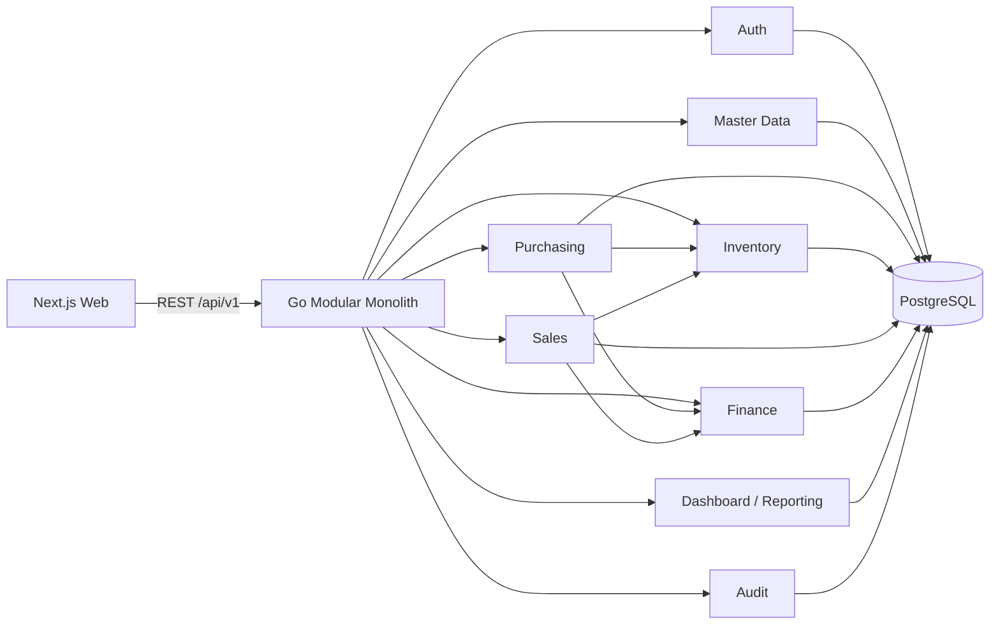

# Phase 1 Architecture and Design Proposal

## 1. Outcome

Mini ERP dirancang sebagai web application end-to-end untuk satu perusahaan UMKM, dengan satu deployment backend Go berbentuk modular monolith. BPMN 2.0 adalah source of truth untuk urutan proses dan state transition. Implementasi kelak wajib mengikuti mapping stabil dari BPMN task ke requirement, UI, API, use case, operasi database, state transition, dan automated test.

Ini arsip keputusan desain awal yang disetujui pada 2026-09-21. Beberapa aturan role dan alur sudah berubah; untuk kondisi implementasi saat ini lihat `RBAC-AUDIT.md` dan `bpm-haqi/README.md`. Dokumen ini bukan bukti penerimaan runtime.

## 2. Scope Phase 1

Termasuk:

- actor, permission boundary, domain boundary, dan business rules;
- BPMN Level 0, Level 1, dan Level 2 untuk tiga proses utama;
- convention untuk stable BPMN ID;
- initial traceability matrix;
- proposal ERD, state machine, REST API, dan repository layout;
- review atas gap, ambiguitas, semantics BPMN, ownership, dan coverage mapping.

Tidak termasuk:

- source code Next.js atau Go;
- SQL migration dan seed;
- Docker image atau Docker Compose runtime;
- workflow engine, message broker, microservices, dan external accounting integration;
- purchase return, sales return/refund, warehouse transfer, tax engine, stock reservation, advanced cancellation/short-close, general ledger, serta external notification integration;
- UI mockup final. Gambar referensi hanya menjadi arah visual: sidebar ringan, workspace terang, kartu ringkas, dan visual hierarchy yang rapi.

## 3. Architecture decisions

### AD-001 — Modular monolith

Satu Go binary dan satu PostgreSQL database. Domain dipisahkan sebagai module internal: `auth`, `masterdata`, `purchasing`, `inventory`, `sales`, `finance`, `reporting`, dan `audit`. Tidak ada service-to-service network call.

### AD-002 — Clean Architecture per domain

Setiap module memiliki lapisan:

1. `domain`: entity, value object, state transition, dan domain error; tidak mengimpor HTTP, SQL, atau framework.
2. `application`: satu use case per operation dan port yang dibutuhkan oleh use case.
3. `adapter`: HTTP handler dan PostgreSQL repository yang menerjemahkan detail luar ke/dari model application.

`cmd/api` menjadi composition root. Arah dependency selalu masuk: adapter → application → domain.

### AD-003 — BPMN-governed, tanpa workflow engine pada MVP

BPMN disimpan dan direview sebagai source of truth. Go use case menegakkan transition yang sama secara eksplisit. Workflow engine tidak ditambahkan sampai ada kebutuhan runtime orchestration seperti timer lintas hari, perubahan alur oleh non-developer, atau recovery process instance yang kompleks.

### AD-004 — Transactional consistency

Satu business command, state transition, stock movement, financial posting, dan audit trail yang terkait harus commit dalam satu database transaction. Kegagalan salah satu bagian membatalkan semuanya.

### AD-005 — Ledger-first inventory

`stock_movements` dan `stock_movement_lines` adalah source of truth. `stock_balances` hanya projection/cache untuk query cepat dan dapat dibangun ulang dari ledger. Semua movement memiliki source document type dan ID.

### AD-006 — Explicit action endpoints

CRUD dipakai untuk draft dan master data. Business transition menggunakan command endpoint seperti `/submit`, `/approve`, `/post`, dan `/void`. Endpoint transition harus menolak status asal yang tidak valid dengan `409 state_conflict`.

### AD-007 — Immutable posting

Document yang sudah memengaruhi stock atau finance tidak diedit atau dihapus. Koreksi dilakukan dengan reversal document yang memiliki referensi ke posting asal dan audit trail lengkap.

### AD-008 — Secure browser session and first-Admin bootstrap

Web menggunakan opaque access/refresh session melalui cookie `Secure`, `HttpOnly`, `SameSite=Lax`, bukan token di browser storage. Refresh token dirotasi dengan reuse detection; unsafe request memakai synchronizer CSRF token dan trusted-origin validation. Password di-hash dengan Argon2id. Admin pertama hanya dapat dibuat oleh CLI lokal yang menolak berjalan setelah user pertama ada; tidak tersedia bootstrap endpoint atau default credential.

## 4. Context and boundaries

Module berkomunikasi melalui application ports atau orchestration use case dalam process owner module. Module tidak mengakses tabel module lain secara bebas. Transaction manager berada di platform layer dan menerima unit of work lintas repository dalam proses yang sama.

## 5. Process hierarchy

| Level | Purpose | Artifact |
|---|---|---|
| 0 | Enterprise process landscape dan supporting capabilities | `docs/bpmn/l0-enterprise-landscape.bpmn` |
| 1 | Access Lifecycle dan tiga end-to-end operational process dalam phase-level view | `docs/bpmn/l1-core-processes.bpmn` |
| 2 | Detailed executable business workflow | empat file `l2-*.bpmn` |
| 3 | Mapping BPMN ke software, bukan diagram BPMN teknis | `docs/PROCESS-MAPPING.md` |

Level 2 menggunakan pool untuk participant, lane untuk role internal, sequence flow hanya di dalam pool/process, dan message flow hanya antar-pool. Service task berarti automation yang kelak dijalankan oleh Go use case dalam request transaction, bukan worker eksternal.

## 6. UI direction

Navigasi utama:

- Dashboard
- Purchasing
- Sales
- Inventory
- Finance
- Master Data
- Users
- Settings

Prinsip visual: sidebar tetap sederhana, satu primary action per page, tabel dengan filter yang jelas, status badge konsisten, progressive disclosure untuk detail, mobile layout tanpa tabel lebar yang dipaksakan, dan warna status tidak menjadi satu-satunya pembeda. Dashboard hanya menampilkan metric yang dapat ditindaklanjuti: pending approvals, low stock, receivable due, payable due, dan recent activity.

## 7. Cross-cutting policies

- Semua ID internal menggunakan UUID; nomor dokumen manusia menggunakan sequence per document type.
- Timestamp disimpan sebagai `timestamptz` UTC dan ditampilkan dalam timezone organisasi.
- Quantity memakai `numeric(18,4)`; monetary amount memakai `numeric(18,2)` dan currency ISO 4217.
- Optimistic concurrency menggunakan integer `version` dan request header `If-Match` pada update/transition.
- Setiap mutating request menerima `Idempotency-Key` untuk mencegah posting ganda.
- Audit record bersifat append-only dan tidak dapat diubah dari API aplikasi.
- Audit memakai `trace_id` stabil: BPMN task ID untuk task Level 2 atau action ID untuk lifecycle/recovery command. Secret dan raw token selalu disunting.
- Soft delete tidak dipakai untuk transaksi. Master data dinonaktifkan dengan status `INACTIVE`.
- Maker-checker selalu aktif: creator tidak dapat menyetujui dokumennya sendiri dan tidak ada override pada MVP.
- Currency default `IDR`, timezone default `Asia/Jakarta`, dan default warehouse disimpan sebagai organization settings.
- Database mendukung banyak warehouse; UI MVP boleh memakai satu default warehouse.
- Stock reservation dan negative stock dilarang; stock selalu divalidasi ulang sebelum posting keluar/adjustment.
- Raw access, refresh, CSRF, invitation, dan password-reset token tidak pernah disimpan di audit/log; invitation/reset token hanya disimpan sebagai hash dan berlaku 24 jam.

## 8. Acceptance gate for Phase 1

Baseline Phase 1 telah melewati gate berikut:

1. keputusan OD-001–OD-010 telah diputuskan;
2. setiap Level 2 task memiliki stable ID dan satu row mapping;
3. setiap transition API cocok dengan state machine dan BPMN;
4. setiap stock/finance posting memiliki atomic audit operation;
5. BPMN XML well-formed dan lolos semantic review;
6. tidak ada module dependency yang melanggar dependency rule;
7. user menyetujui baseline sebelum implementation plan dibuat.

Gate di atas menjelaskan keputusan historis Phase 1, bukan status verifikasi aplikasi saat ini.
