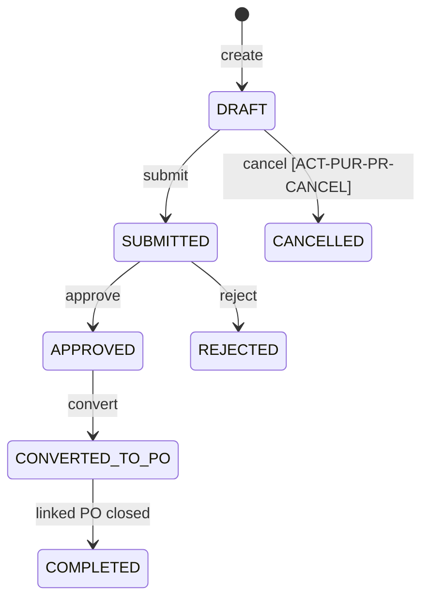
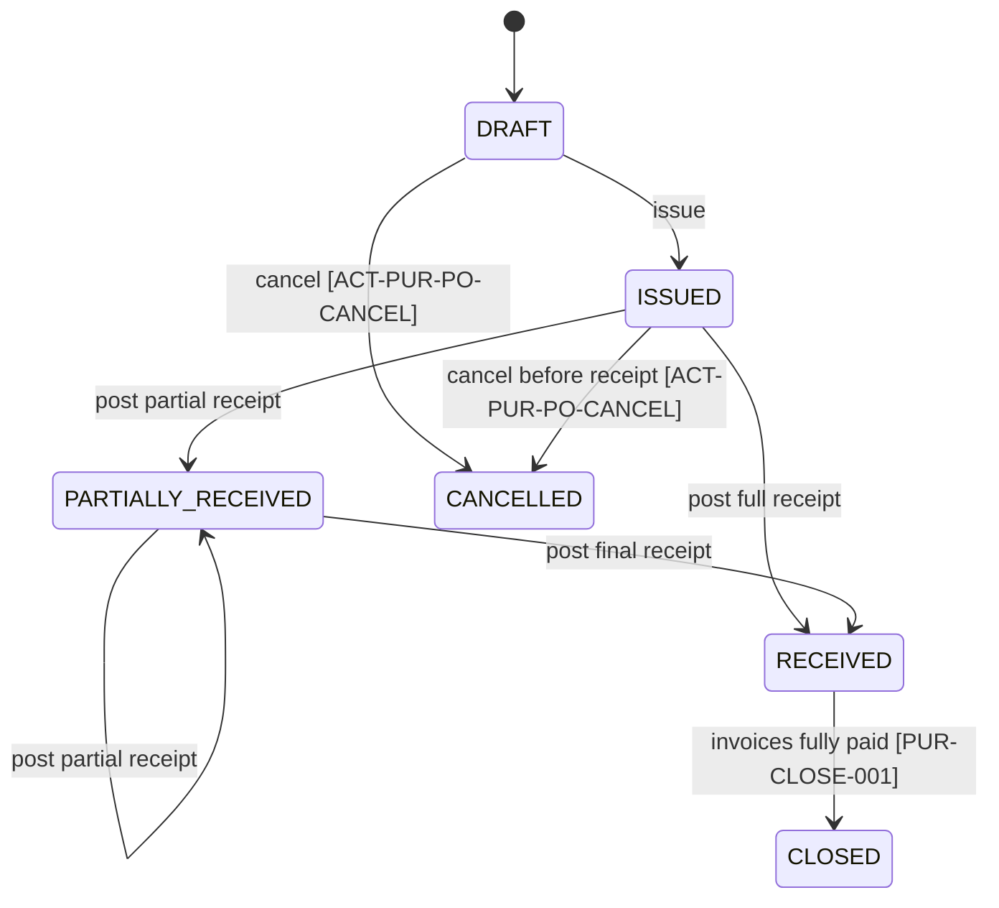
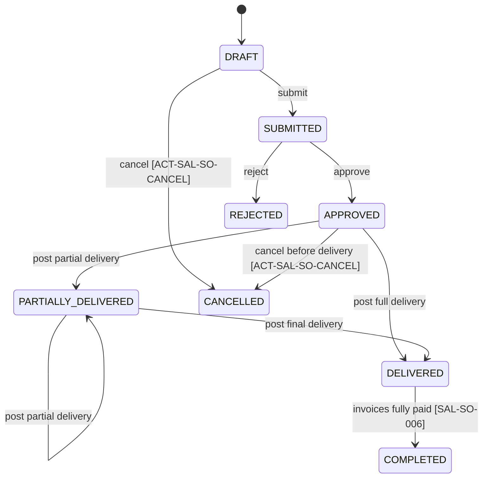
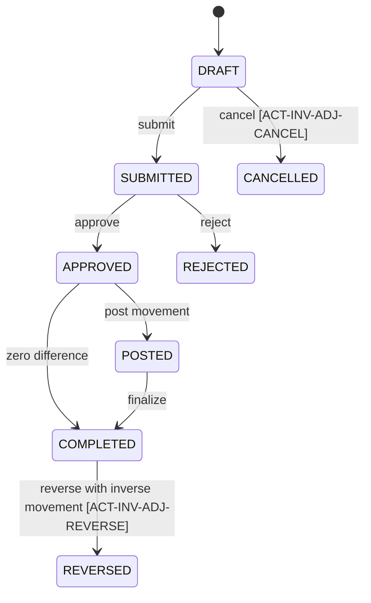
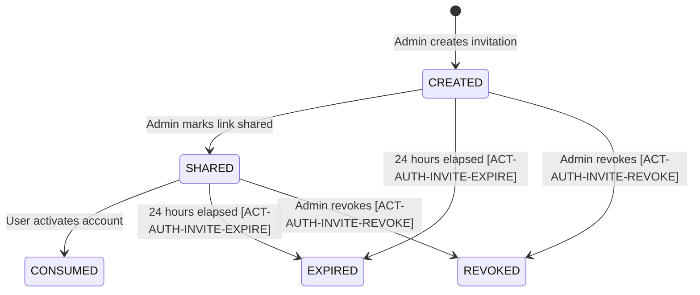
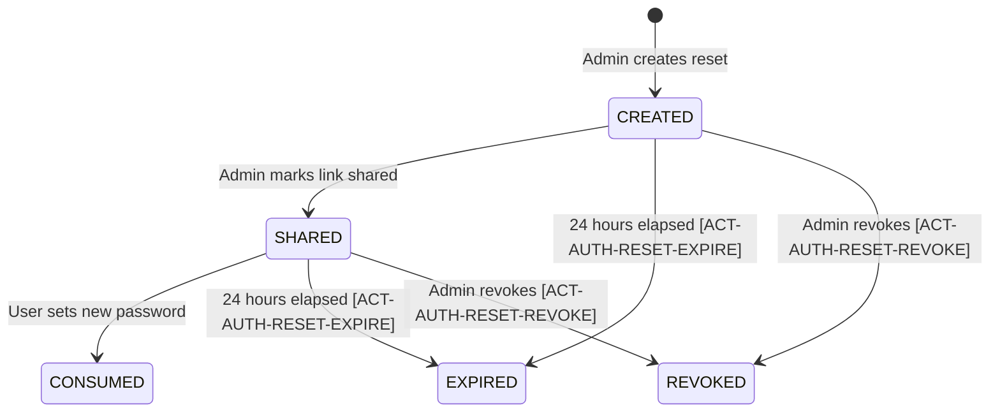

# Business Document State Machines

State transitions below are normative. Only the listed command may change state; direct status update endpoints are forbidden.

## Purchase Request

| From | Command | To | Actor / trigger |
|---|---|---|---|
| DRAFT | submit | SUBMITTED | Admin/Operator |
| SUBMITTED | approve | APPROVED | Admin |
| SUBMITTED | reject | REJECTED | Admin |
| APPROVED | convert | CONVERTED_TO_PO | Admin/Operator |
| CONVERTED_TO_PO | close source | COMPLETED | System |
| DRAFT | cancel (`ACT-PUR-PR-CANCEL`) | CANCELLED | Creator/Admin; reason required |

`REJECTED` is terminal. `Copy to draft` (`ACT-PUR-PR-COPY`) creates a new Purchase Request with a new identity and `copied_from_id`; it is not a transition of the rejected document. Approve/reject also requires `reviewed_by != created_by`.

## Purchase Order

Cancellation after any receipt is prohibited; reversal and close is required.

A supplier-payment void that makes the consolidated invoice outstanding again reopens `CLOSED → RECEIVED` and its Purchase Request `COMPLETED → CONVERTED_TO_PO` in the same transaction. This is a deterministic consequence of `ACT-FIN-SPAY-VOID`, not manual close/reopen.

## Goods Receipt

`DRAFT → POSTED → REVERSED`, with `DRAFT → CANCELLED`. Cancellation uses `ACT-PUR-GR-CANCEL`; reversal uses `ACT-PUR-GR-REVERSE`. Only `POSTED` changes stock. Reversal creates a new paired stock movement; it never deletes the original. Both require a reason and audit. Reversal is blocked by an active supplier invoice or a negative resulting stock balance.

## Supplier Invoice

`[*] → MATCH_PENDING → POSTED → PARTIALLY_PAID → PAID`; `MATCH_PENDING → MATCH_EXCEPTION → MATCH_PENDING`; `POSTED → VOID` through reversal (`ACT-FIN-SINV-VOID`). Payment allocation drives payment states; payment void can move `PAID|PARTIALLY_PAID → PARTIALLY_PAID|POSTED` based on recalculated outstanding.

`VOID` requires Admin, mandatory reason, reversal reference, and audit trail. No second approver is required. An invoice with an active payment allocation cannot be voided; its payments must be voided first. A replacement invoice may then reference the VOID invoice.

## Supplier Payment

`DRAFT → POSTED → VOID` (`ACT-FIN-SPAY-VOID`). Posting updates allocations and invoice outstanding amount atomically.

`VOID` requires Admin, mandatory reason, reversal allocation, and audit trail. No second approver is required.

## Sales Order

`REJECTED` is terminal. `Copy to draft` (`ACT-SAL-SO-COPY`) creates a new Sales Order with a new identity and `copied_from_id`. Approve/reject requires `reviewed_by != created_by`. Administrative short-close is not a valid transition. `SAL-SO-006` runs automatically in the final-payment transaction; there is no manual close command.

A customer-payment void that makes the consolidated invoice outstanding again reopens `COMPLETED → DELIVERED` in the same transaction. This is a deterministic consequence of `ACT-FIN-CPAY-VOID`, not a manual reopen command.

## Delivery

`DRAFT → POSTED → REVERSED`, with `DRAFT → CANCELLED`. Cancellation uses `ACT-SAL-DLV-CANCEL`; reversal uses `ACT-SAL-DLV-REVERSE`. Only `POSTED` changes stock and may be invoiced. Both correction commands require a reason and audit. Reversal is blocked while a non-VOID sales invoice exists.

## Sales Invoice

`[*] → POSTED → PARTIALLY_PAID → PAID`; `POSTED → VOID` through reversal (`ACT-FIN-CINV-VOID`). Payment void can move `PAID|PARTIALLY_PAID → PARTIALLY_PAID|POSTED` based on recalculated outstanding.

`VOID` requires Admin, mandatory reason, reversal reference, and audit trail. No second approver is required. An invoice with an active payment allocation cannot be voided; its payments must be voided first. A replacement invoice may then reference the VOID invoice.

## Customer Payment

`DRAFT → POSTED → VOID` (`ACT-FIN-CPAY-VOID`). Posting updates allocations and invoice outstanding amount atomically.

`VOID` requires Admin, mandatory reason, reversal allocation, and audit trail. No second approver is required.

## Inventory Adjustment

Approval and posting may be one API transaction from the user's perspective, but remain distinct domain transitions and audit entries so `APPROVED` is never bypassed.

## Stock Movement

A movement is created directly as `POSTED` and has no mutable lifecycle. Reversal creates a separate `POSTED` movement of type `REVERSAL` with `reversal_of_id`; the original movement and lines remain unchanged. The inverse movement is rejected if its projected result would be negative.

## Master data lifecycle

Product, Supplier, Customer, Warehouse, and User use `ACTIVE → INACTIVE`, with optional `INACTIVE → ACTIVE` by Admin. In-use records cannot be hard deleted. A User additionally has credential states `INVITED → ACTIVE → LOCKED|INACTIVE`; successful unlock returns `LOCKED → ACTIVE`.

## User Invitation

Invitation consumption atomically changes the linked User from `INVITED → ACTIVE`. Expired, consumed, or revoked tokens cannot be reused.

## Password Reset

Reset consumption atomically replaces the password hash, revokes all access/refresh sessions, unlocks a `LOCKED` user, and records audit without persisting the raw token.

## Authentication Session

`ACTIVE → ROTATED → REVOKED|EXPIRED`. Refresh creates new opaque access/refresh values and marks the prior refresh token used. Reuse of any rotated refresh token revokes every session in the token family. `ACT-AUTH-SESSION-REVOKE` revokes all active sessions for a user; logout revokes the current session. Raw access, refresh, CSRF, invitation, and reset token values never enter audit data.

## Transition enforcement contract

Every state-changing use case must:

1. load aggregate by ID with version;
2. authorize capability and enforce mandatory maker-checker (`created_by != reviewed_by`) where approval applies;
3. invoke an aggregate transition method;
4. persist with `WHERE id = ? AND version = ?`;
5. revalidate stock/source/version immediately before inventory posting and perform related ledger/projection writes in the same transaction;
6. append audit entry with the stable BPMN task ID or supporting action ID;
7. return the new state and incremented version.
